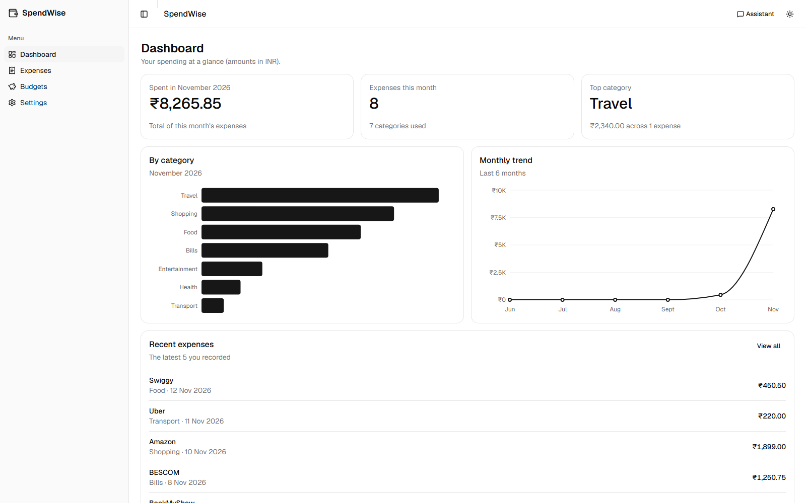
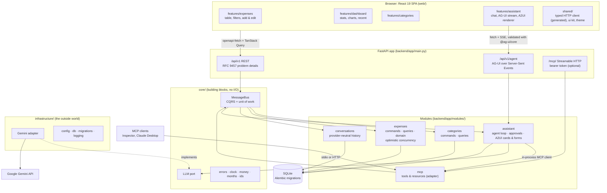

# 💸 SpendWise

<div align="center">
  
  
  
  
  
  
  
  
  
  
  
  
  
</div>
<br>

<div align="center">
  
</div>
<br>

**SpendWise** is an agentic expense tracker. You record and explore expenses on a web app, or ask an AI assistant
in plain words: *"add 250 for lunch at Subway"*, *"where did my money go this month?"*, *"delete #14"*. The assistant
works through the same rules as the app: it reads and changes data only through MCP tools, streams its answer and
its tool activity live (AG-UI), shows cards, charts and forms drawn from data (A2UI), and never deletes anything
until you press **Approve**.

It runs on a **FastAPI modular monolith with CQRS** and a **React app organised as feature slices**, with one typed
contract generated from the backend. Every design decision is recorded with its reasoning, and each delivery phase
has an engineering note ([docs/](docs/README.md)).

---

## 🏗️ System Architecture

One backend process, deployed as one unit, divided into **modules by business domain** that talk only through
their contracts and a **command/query bus**. The web app talks to it through a **generated, typed contract**.



---

## 🌟 Core Architectural Principles

- **Modular monolith, strictly bounded:** each module (`categories`, `expenses`, `conversations`, `assistant`) owns
  its tables, contracts and handlers. Another module's names come only from its package (`app.modules.expenses`), never
  its files; no module queries another's tables; links are plain ids with no cross-module foreign keys.
  Outside the modules, shared code is grouped by concern: `core/` (building blocks) imports nothing else,
  `infrastructure/` and `web/` import only `core/`, and `bootstrap.py` is the one composition root.
- **Vertical slices inside a module:** each command or query is one file holding the message and its handler, so a
  use case is one file to read and adding one is a new file plus one registration line.
- **CQRS-lite with a unit of work:** every operation is a **command** (changes data, returns at most an id) or a
  **query** (reads, changes nothing), sent through `MessageBus`. The bus opens one session per outermost command,
  commits once, rolls back on error, and gives nested commands a SAVEPOINT. Same database for reads and writes.
- **Ports and adapters:** the LLM (`core/llm`: provider-neutral messages, Gemini behind narrow model ports) and the
  assistant's expense tools (an `ExpenseTools` port over MCP) are interfaces; the composition root picks the adapter.
  Chat history is stored in SpendWise's own message format, so another provider is one new adapter.
- **MCP is the agent's only door to data:** the assistant has no tools of its own. It discovers this app's MCP server
  and calls it **in-process** by default (no HTTP to itself). Tools return **typed, structured results**
  (`outputSchema`), so cards never guess at JSON keys.
- **Human in the loop, enforced by the server:** in the web panel the model can't delete. A delete becomes an
  Approve/Cancel card; the server keeps a snapshot of what the card showed, and Approve deletes only that **version**
  (checked in the `DELETE` statement itself). Each card decides once, in its own thread, within 15 minutes.
- **Server-driven UI, safely:** cards and forms are **A2UI** descriptions (data, not HTML). The renderer maps an
  allow-list of components to its own, refuses unknown catalogs, loops, runaway sizes and deep nesting, and puts
  every card behind its own error boundary.
- **Streaming you can follow:** replies stream as **AG-UI** events (text, tool calls with live status chips, state,
  cards); the browser validates every event with AG-UI's own schemas, and a **Stop** button ends a run.
- **Feature slices on the web:** `features/<name>/` owns its components, hooks, API calls and types and exports
  through `index.ts`; `shared/` knows no feature; `app/` composes them. Lint rules enforce it.
- **One contract, generated:** REST types (OpenAPI → `schema.gen.ts`) and protocol names, labels and limits
  (`contracts.gen.ts`) come from the backend. No magic strings, nothing copied by hand.
- **Correct by construction:** money as integer paise with `Decimal`, Alembic migrations (atomic on SQLite too),
  RFC 9457 problem details for every error, a `Clock` instead of `date.today()`, and user data logged only at DEBUG.

---

## 📚 Documentation Index

| Category | Guide | Description |
|---|---|---|
| **Overview & Architecture** | [**Overview**](./docs/overview.md) | What SpendWise does, its features, the tech stack and the roadmap. |
| | [**Architecture**](./docs/architecture.md) | Module rules, CQRS and the bus, request flows, feature slices, the shared contract, adding a module. |
| | [**Assistant Architecture**](./docs/assistant_architecture.md) | The agent loop, tools over MCP, AG-UI streaming, A2UI cards and forms, approvals, memory and cost. |
| | [**How SpendWise Works**](./docs/how_spendwise_works.md) | The main flows as diagrams: recording, asking, deleting with approval, data staying in sync. |
| | [**Architecture Review**](./docs/architecture-review.md) | Every finding of the architecture review and the code reviews, and how each was resolved. |
| | [**Decision Log**](./docs/decisions.md) | Every design decision, with why, and when to revisit it. |
| **Developer Onboarding** | [**Getting Started**](./docs/getting_started.md) | Setup from zero: Python, Node, `.env`, migrations, sample data, the web app, MCP clients. |
| | [**Backend Onboarding**](./docs/backend_onboarding.md) | Working in the backend: adding a command, query, route, migration or MCP tool, step by step. |
| | [**Frontend Onboarding**](./docs/frontend_onboarding.md) | Working in the web app: feature slices, TanStack Query, the generated client, the A2UI renderer. |
| | [**Web README**](./web/README.md) | The web app's scripts and folders. |
| | [**Rules for AI agents**](./AGENTS.md) | The rules every change must follow, for AI coding agents and people alike: architecture, layout, documentation, verification, the working agreement. |
| **Contracts, Schema & Security** | [**API Endpoints**](./docs/api_endpoints.md) | Every REST route, the AG-UI stream, MCP tools and resources, the error format, with examples. |
| | [**Database Schema**](./docs/database_schema.md) | Tables, columns, indexes, which module owns what, and the migrations. |
| | [**Configuration**](./docs/configuration.md) | Every setting (backend `.env`, web `.env`), defaults, and the generated contract. |
| | [**Security**](./docs/security.md) | What protects what (CORS, MCP token, approvals, prompt injection, the renderer), and known gaps. |
| **Engineering Record** | [**Phase notes**](./docs/README.md#phase-notes) | Phases 1–18 and the refactors: design, what was built, how to verify it, design questions. |
| | [**Sources**](./docs/sources.md) | What the official docs, specs and library code say, with links. |
| | [**Gemini**](./docs/gemini.md) · [**Troubleshooting**](./docs/troubleshooting.md) · [**Git**](./docs/git.md) | Models and the free tier; problems already hit; committing safely. |

---

## ⚡ Quick Start (Windows)

### 1. Start the backend

From the project folder (the repo root, where `run.ps1` is):

```powershell
Copy-Item .env.example .env     # once, then paste your Gemini API key into .env
.\run.ps1                       # creates .venv, installs requirements, runs the migrations, starts the server
```

> [!IMPORTANT]
> **A Gemini API key is needed for the assistant.** Get one at https://aistudio.google.com/apikey and put it after
> `GEMINI_API_KEY=` in `.env`. Everything else (the Dashboard, the Expenses page, the REST API, MCP) works without it.

### 2. Add sample data (optional, safe to run more than once)

```powershell
.\.venv\Scripts\python.exe backend\seed.py
```

### 3. Start the web app

```powershell
cd web
npm install      # first time, and after package.json changes
npm run dev      # then open http://localhost:5173
```

Requirements: Python 3.11+ (developed on 3.14) and Node.js 20+ (developed on 24). Full setup, macOS/Linux commands
and MCP clients: [docs/getting_started.md](docs/getting_started.md).

---

## 🌐 Local Access Points

| Service | Local URL | Purpose |
|---|---|---|
| **Web app (React)** | `http://localhost:5173` | Dashboard, Expenses page, the Assistant panel |
| **Backend API (FastAPI)** | `http://127.0.0.1:8000/api/v1` | REST API (expenses, categories, summaries, the assistant) |
| **API docs (Swagger UI)** | `http://127.0.0.1:8000/docs` | Try every route in the browser; ReDoc at `/redoc` |
| **OpenAPI document** | `http://127.0.0.1:8000/openapi.json` | The contract the web app's types are generated from |
| **Health check** | `http://127.0.0.1:8000/health` | `{"status": "ok"}` when the server and its database are up |
| **AG-UI stream** | `POST http://127.0.0.1:8000/api/v1/agent` | The assistant's streamed runs (Server-Sent Events) |
| **MCP over HTTP** | `http://127.0.0.1:8000/mcp/` | Only when `MCP_TOKEN` is set; send `Authorization: Bearer <token>` |
| **MCP over stdio** | `.\.venv\Scripts\python.exe backend\mcp_stdio.py` | For MCP Inspector and Claude Desktop; no web server needed |

---

## 📁 Project Layout

```
spendwise/
  backend/
    app/
      main.py             the web app: routes under /api/v1, /health, /mcp/, error handling, CORS
      bootstrap.py        the composition root: modules, bus, LLM adapter, MCP server, routers
      core/               building blocks: cqrs (the bus), errors, ids, clock, months, money, llm/ (the port)
      infrastructure/     the outside world: config, db, migrations, logging, llm/ (the Gemini adapter)
      web/                what every route shares: dependencies (BusDep, ClockDep), problems (RFC 9457 errors)
      modules/
        categories/       commands/ and queries/ (one file per message: the message and its handler), values,
                          models, persistence/ (tables), api, module
        expenses/         + domain/ (business rules) and persistence/repository.py (the write side)
        conversations/    chat threads, stored as provider-neutral messages
        assistant/        api/ (routes, AG-UI in and out), application/ (use cases), agent/ (the loop),
                          approvals/, tools/ (port + MCP adapter), a2ui/ (cards & forms)
        mcp/              MCP server: typed tool contract, tools/ (one file per tool), resources, HTTP endpoint
    migrations/           Alembic: 0001 baseline, 0002 conversations + approvals, 0003 expense versions,
                          0004 conversation index
    scripts/              export_contracts.py: the contract for the web app
    seed.py               sample categories and expenses
    mcp_stdio.py          the MCP server over stdio
  web/
    src/app/              providers, routes, layout, the list of text namespaces
    src/features/         expenses, categories, dashboard, assistant (each with its texts in i18n/)
    src/shared/           ui kit, typed API client + generated contract, config, languages (i18n), formatting, theme
  docs/                   architecture, onboarding, API, schema, security, decisions, phase notes
  run.ps1                 one-command dev start (Windows)
  requirements.txt        pinned backend dependencies
  .env.example            every setting the app reads, with no secret values
```

---

## 📏 Conventions

### Virtual environment

- One venv per project, in `.venv` in the project folder. Never install project packages into the global Python.
- Run tools as `python -m pip`, `python -m uvicorn`, `python -m alembic` rather than bare commands, so they run with
  the same Python as the app. `run.ps1` calls the venv's Python directly, so no activation is needed.
- `.venv` is never committed and can be rebuilt from `requirements.txt` at any time. If you move or rename the
  project folder, delete `.venv` and create it again: a venv stores absolute paths.
- In VS Code, the repo's `.vscode/settings.json` already points at `.venv`.

### Dependencies

- `requirements.txt` and `web/package.json` pin **exact** versions, so every machine installs the same thing.
- To add a backend dependency: `python -m pip install <package>`, read the version with `python -m pip show
  <package>`, add `<package>==<version>` to `requirements.txt`, and commit it with the code that uses it.
- To add a web dependency: `npm install --save-exact <package>@<version>`.

### Configuration and secrets

- Secrets and machine-specific settings live in `.env`, never in code. `.env` is git-ignored; `.env.example` is
  committed and lists every setting with no real values. All settings are read in
  `backend/app/infrastructure/config.py`; real environment variables override `.env`. Details:
  [docs/configuration.md](docs/configuration.md).

### Money

- Amounts are stored as whole **paise** (integer minor units) plus a currency code, default `INR`: 450.50 rupees is
  stored as `45050`. Convert only with `app.core.money`, which uses `Decimal`. Never put money through a `float`.

### Database and generated files

- `backend/spendwise.db` is your local data (git-ignored). Its tables are created and changed only by **migrations**;
  `.\run.ps1` and `seed.py` run them. To start from scratch, delete the file and run `seed.py`.
- `web/src/shared/api/*.gen.ts` and `web/openapi.json` are generated from the backend: after changing an API, run
  `.\.venv\Scripts\python.exe backend\scripts\export_contracts.py`, then `npm run gen:api` in `web/`, and commit them.
- `__pycache__/` and `web/dist/` are build output: git-ignored and safe to delete.

### What gets committed

| Commit | Never commit |
|---|---|
| Source code (`backend/`, `web/src/`), migrations, generated contracts | `.venv/`, `node_modules/`, `web/dist/` |
| `requirements.txt`, `web/package.json`, `web/package-lock.json` | `__pycache__/`, `*.pyc` |
| `.env.example`, `docs/`, `README.md`, `run.ps1` | `.env`, `*.db` (your local database) |

Update `docs/` in the same commit as the code it describes ([docs/README.md](docs/README.md)).
