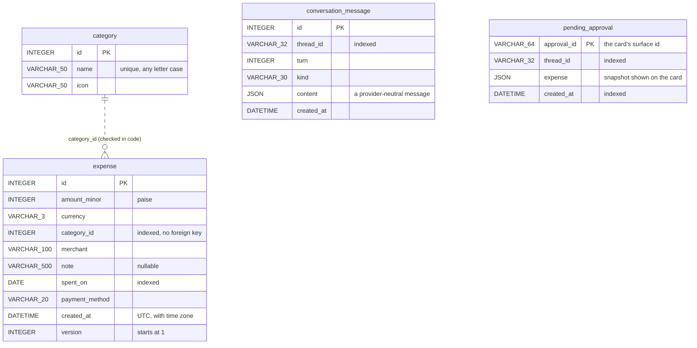

# Database Schema

SpendWise keeps everything in one database: a SQLite file, `backend/spendwise.db`, by default (`DATABASE_URL` can
point elsewhere, e.g. Postgres). Each table belongs to **exactly one module**, and only that module reads or writes it.

## Tables at a glance



The dotted line is a link kept **in code**, not by the database: there are no foreign keys between modules (below).
`pending_approval.thread_id` and `conversation_message.thread_id` name the same conversations, also without a key.

| Table | Owner module | Holds |
|---|---|---|
| `category` | categories | the spending categories |
| `expense` | expenses | every expense |
| `conversation_message` | conversations | chat history, one row per message |
| `pending_approval` | assistant | delete cards waiting for Approve or Cancel |
| `alembic_version` | (migrations) | which migration the database is at |

## `category`

| Column | Type | Notes |
|---|---|---|
| `id` | INTEGER, primary key | |
| `name` | VARCHAR(50), not null | unique index `ix_category_name`; the app also refuses names that differ only in letter case ("food" vs "Food") |
| `icon` | VARCHAR(50), not null | an icon *name* (`utensils`), mapped to a picture by the web app |

## `expense`

| Column | Type | Notes |
|---|---|---|
| `id` | INTEGER, primary key | shown everywhere as `#14` |
| `amount_minor` | INTEGER, not null | **whole paise**: ₹450.50 is `45050`. Never a float |
| `currency` | VARCHAR(3), not null | ISO 4217 code, default `INR` |
| `category_id` | INTEGER, not null | index `ix_expense_category_id`. **No foreign key**: the expenses module asks the categories module whether the category exists |
| `merchant` | VARCHAR(100), not null | trimmed of spaces |
| `note` | VARCHAR(500), nullable | |
| `spent_on` | DATE, not null | index `ix_expense_spent_on` ("this month" is the most common query) |
| `payment_method` | VARCHAR(20), not null | `cash`, `upi`, `card`, `netbanking`, `wallet` or `other` |
| `created_at` | DATETIME with time zone, not null | UTC, set from the app's clock |
| `version` | INTEGER, not null, default 1 | raised by one on every update: **optimistic concurrency** |

### Why `version`

The assistant's Approve card shows an expense and later deletes it. If the expense was edited in between (from the
table, another tab, an MCP client), deleting it would remove something the user never saw. So the delete is one
statement:

```sql
DELETE FROM expense WHERE id = :id AND version = :version_on_the_card
```

If it deletes nothing, the expense changed (or is gone), and the user is told so. No lock is held while waiting for
the user, and nothing can slip in between the check and the delete.

## `conversation_message`

| Column | Type | Notes |
|---|---|---|
| `id` | INTEGER, primary key | also the order of messages |
| `thread_id` | VARCHAR(32), not null | index `ix_conversation_message_thread_id` |
| `turn` | INTEGER, not null | 1 for the first user message of a thread, 2 for the next, … Only the last 10 turns are resent to the model |
| `kind` | VARCHAR(30), not null | `user_text`, `assistant_text`, `tool_call`, `tool_result` or `reasoning` (also inside `content`) |
| `content` | JSON, not null | the message, in SpendWise's own format, not any provider's |
| `created_at` | DATETIME with time zone, not null | |

What `content` looks like for each kind:

```json
{"kind": "user_text", "text": "Add 250 for lunch at Subway"}
{"kind": "assistant_text", "text": "Saved ₹250 at Subway."}
{"kind": "tool_call", "call_id": "c1", "name": "add_expense", "arguments": {"amount": "250", "merchant": "Subway"}}
{"kind": "tool_result", "call_id": "c1", "name": "add_expense", "output": "{…}", "is_error": false}
{"kind": "reasoning", "provider": "gemini", "opaque": {"signature": "c2ln…"}}
```

A turn is written in one transaction once it has finished, so a thread never holds half a turn. `reasoning` keeps a
provider's private data (Gemini's thought signature, needed to continue after a tool call) for that provider only.

## `pending_approval`

| Column | Type | Notes |
|---|---|---|
| `approval_id` | VARCHAR(64), primary key | the Approve/Cancel card's surface id, what the browser sends back |
| `thread_id` | VARCHAR(32), not null | index; a card can only be answered in its own conversation |
| `expense` | JSON, not null | the expense exactly as the card showed it, including its `version` |
| `created_at` | DATETIME with time zone, not null | index; cards expire after 15 minutes |

At most 200 are kept (oldest forgotten first). Taking a card removes it, so each card decides once; if the decision
fails midway, the card is put back unchanged (same age).

## Rules every table follows

- **One owner.** Only the owning module's handlers touch a table. Other modules ask through the bus
  (`categories.GetCategory`), never with SQL.
- **No foreign keys between modules.** A foreign key would tie two modules together in the database. The trade-off:
  the database doesn't guard the link, so the owning module's command checks it (`CreateExpense` asks whether the
  category exists), and readers handle a missing one (`"Unknown"`).
- **Transactions come from the bus.** Handlers never commit; the bus commits once per command and rolls back on error.
  Repositories only stage changes.
- **Money in paise, time in UTC.** Integers for money, `Decimal` for conversions; timestamps stored with their time
  zone, converted for display by the web app.

## Migrations

The tables are created and changed only by **Alembic migrations** in `backend/migrations/versions/`:

| Revision | What it does |
|---|---|
| `0001_baseline` | the schema from Phases 3–18 (`category`, `expense`, `chatmessage`), each table created only if missing, so databases from before migrations keep their data |
| `0002_neutral_conversations` | renames `chatmessage` → `conversation_message` and converts every stored message from Gemini's format to SpendWise's own (and back, on downgrade); adds `pending_approval` |
| `0003_expense_version` | adds `expense.version` (existing expenses start at 1) |

- `.\run.ps1` runs `alembic upgrade head` before starting; `seed.py` and `mcp_stdio.py` do too. The app itself only
  checks, and refuses to start on an out-of-date database with the command to fix it.
- An `upgrade` runs in **one transaction**, schema changes included (SQLite is set up for this in `core/db.py`): if any
  step fails, the database is left exactly as it was.
- Migrations don't import app code: a migration must keep doing exactly what it did after the code changes.
- SQLite can't alter most of a table in place, so changes run in Alembic's **batch mode** (copy into a new table).

Commands (from the project folder):

```powershell
.\.venv\Scripts\python.exe -m alembic -c backend\alembic.ini current                  # where the database is
.\.venv\Scripts\python.exe -m alembic -c backend\alembic.ini upgrade head             # bring it up to date
.\.venv\Scripts\python.exe -m alembic -c backend\alembic.ini downgrade -1             # undo the last one
.\.venv\Scripts\python.exe -m alembic -c backend\alembic.ini revision --autogenerate -m "what changed"
```

Read every generated migration before running it: autogenerate is a draft, not a decision.

## Moving to Postgres later

Set `DATABASE_URL=postgresql+psycopg://…` and run the migrations. What already fits: timestamps with time zone,
`EXTRACT(year/month …)` in the trend query (standard SQL, not SQLite's `strftime`), JSON columns, batch mode (a no-op
outside SQLite). What to revisit then: the SQLite-specific connection settings in `core/db.py` (they apply only to
SQLite), and indexes for the JSON columns if they're ever queried.
