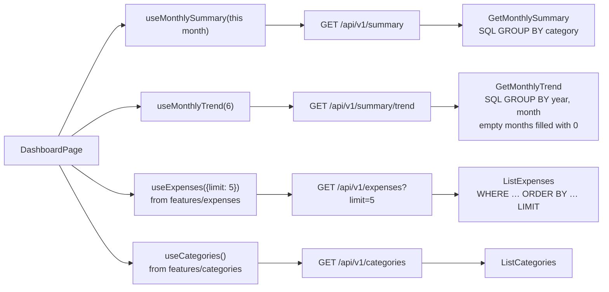
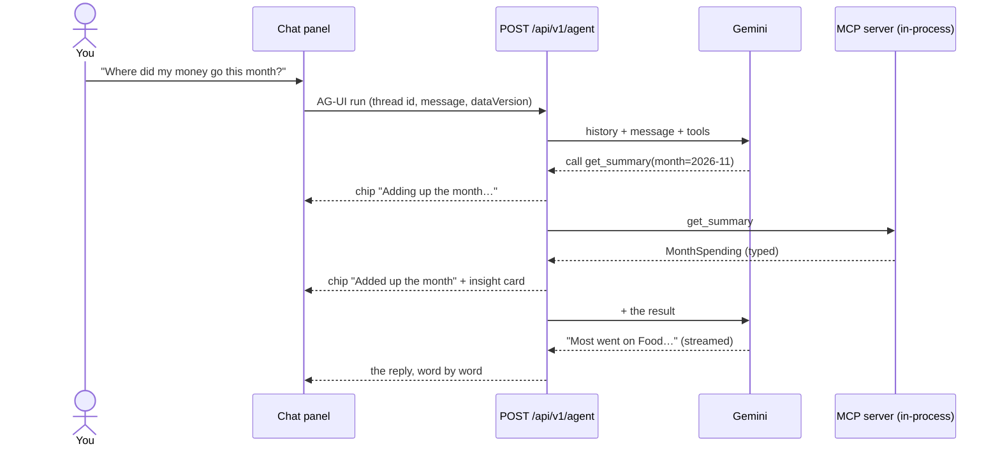
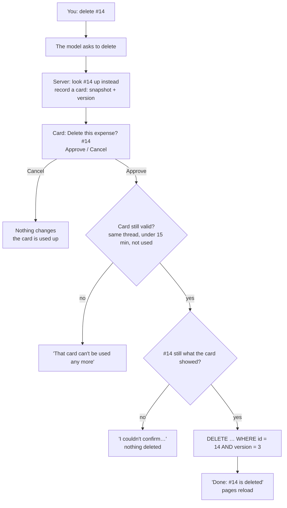
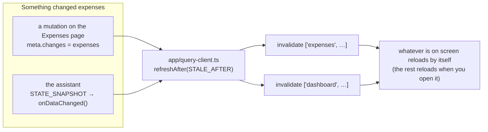
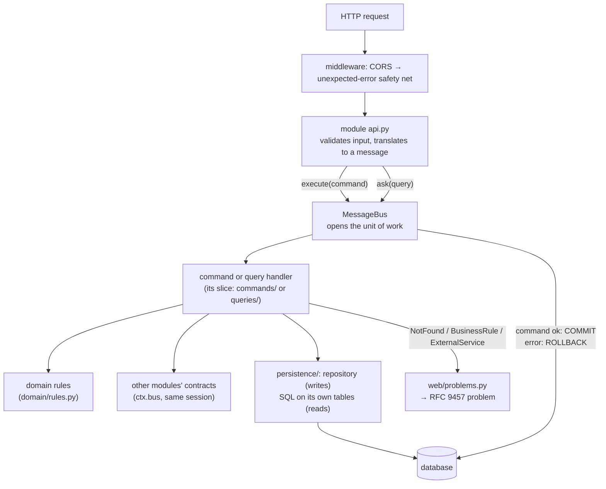

# How SpendWise Works

The main flows, from a click to the database and back, as diagrams. For the rules behind them see
[architecture.md](architecture.md); for the assistant's internals, [assistant_architecture.md](assistant_architecture.md).

## 1. Adding an expense on the Expenses page

```mermaid
sequenceDiagram
    actor You
    participant Dialog as Add expense dialog<br/>(features/expenses)
    participant Query as TanStack Query
    participant API as POST /api/v1/expenses<br/>(expenses/api.py)
    participant Bus as MessageBus
    participant Cmd as create_expense<br/>(expenses/commands/create_expense.py)
    participant Cat as categories module
    participant DB as SQLite

    You->>Dialog: amount, merchant, category, date, paid with
    Dialog->>Query: useCreateExpense().mutate(toNewExpense(draft))
    Query->>API: JSON body (typed from the OpenAPI contract)
    API->>API: validate the body (CreateExpense) or 422
    API->>Bus: execute(CreateExpense)
    Bus->>DB: open a session (the unit of work)
    Bus->>Cmd: handle
    Cmd->>Cmd: amount > 0?
    Cmd->>Bus: ask(categories.GetCategory)
    Bus->>Cat: same session
    Cat-->>Cmd: exists
    Cmd->>DB: INSERT (staged, flushed for the id)
    Bus->>DB: COMMIT
    API->>Bus: ask(GetExpense(id))
    API-->>Query: 201 + Location + the expense
    Query->>Query: meta.changes = expenses → invalidate expense lists and Dashboard
    Query-->>You: the table reloads; "Expense added"
```

If anything fails along the way (an unknown category, amount 0), the bus rolls the transaction back, the API answers
with a problem (`422 business-rule`), and the dialog stays open with your values and a toast with the reason.

## 2. Loading the Dashboard



- The four requests go out together; the backend does the adding up, so only totals and 5 rows travel.
- While any is missing: a skeleton. If loading fails: an error card with **Try again** (it retries only what failed).
  If a later reload fails while numbers are on screen: they stay, with a small "couldn't refresh" notice.
- Each answer is cached under a key (`["dashboard", "summary", "2026-11"]`); outdated requests are cancelled.

## 3. Asking the assistant



The reply appears as it's written; each tool shows as a chip that turns into a tick or a cross; cards appear with the
tool result they come from.

## 4. Deleting through the assistant



The model can't delete in the web panel at all; only your Approve does, and only the exact version you saw.

## 5. Keeping every page in sync



Features don't know about each other's pages: the expenses feature only says "I changed expenses", the assistant
only says "data changed", and the app decides, in one place, what that makes out of date.

## 6. A request through the backend's layers



The MCP server is a second adapter over the same bus, so an expense added from Claude Desktop goes through exactly the
same rules as one added on the web page.
