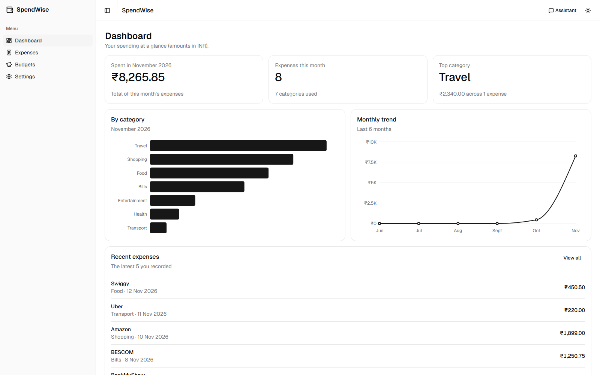

# Overview

SpendWise is an **agentic expense tracker**: a web app for recording and understanding your spending, with an AI
assistant that can do the same things for you in plain words. It was delivered in phases, each with an engineering
note, and every design decision is recorded with its reasoning ([README.md](README.md)).

## What you can do

### On the web app

| Page | What it does |
|---|---|
| **Dashboard** | This month's total, the number of expenses, the top category, a bar chart by category, a 6-month trend line, and the 5 most recent expenses. Reloads by itself when the assistant changes something. |
| **Expenses** | A sortable table of every expense, with search, a category filter and a date range (all filtered on the server). Add expenses in a dialog, edit them in place, delete one or several (after a confirmation). |
| **Assistant panel** | A chat on every page (a side panel on desktop, a sheet on phones). Its replies stream in as they're written. |
| **Budgets** | A monthly limit for all spending and one per category, each with a bar coloured by its state (on track, near the limit, over); the overall bar marks how much of the month has gone by. Set, change or remove a limit in a dialog; step back through earlier months. The Dashboard shows a Budget card too. |

### With the assistant

| You say | What happens |
|---|---|
| *"Add 250 for lunch at Subway today, paid by UPI"* | It records the expense. A chip shows "Saving expense…" → "Expense saved", a card shows the saved expense, and the pages refresh. |
| *"Add lunch"* (details missing) | It shows a **form**, pre-filled with what it understood. You complete it and press Save. |
| *"Where did my money go this month?"* | An **insight card**: total vs last month, the biggest category, and a donut chart. |
| *"Show my Swiggy orders"* | A **list card** of matching expenses, each with its id (`#14`). |
| *"Change #14 to 300"* | It updates the expense and shows the result. |
| *"Delete #14"* | A card with **Approve** and **Cancel**. Nothing is deleted until you press Approve. |

The assistant reads and changes data only through the same tools any MCP client gets, under the same rules as the web
app (an amount must be positive, a category must exist, ...). It cannot delete by itself.

### For other AI tools

The same expense tools are available to any **MCP** client (MCP Inspector, Claude Desktop): `add_expense`,
`list_expenses`, `get_expense`, `get_summary`, `update_expense`, `delete_expense`, `get_monthly_report`, and two
resources (`expenses://categories`, `expenses://recent`). Over stdio with `backend\mcp_stdio.py`, or over HTTP at
`/mcp/` with a bearer token ([api_endpoints.md](api_endpoints.md#mcp-tools-and-resources)).

## The tech stack

| Layer | Technology | Why |
|---|---|---|
| Backend framework | **FastAPI** 0.162 (Python 3.14) | Typed request/response models, OpenAPI for free, native Server-Sent Events |
| Data | **SQLModel** / **SQLAlchemy** 2.1 on **SQLite**, **Alembic** 1.20 migrations | A local file today; `DATABASE_URL` can point at Postgres later |
| Architecture | Modular monolith, **CQRS-lite** with a message bus and unit of work | Clear boundaries without the cost of microservices ([architecture.md](architecture.md)) |
| AI model | **Google Gemini** (Interactions API, streaming, function calling), behind a provider-neutral port | Free tier for development; replaceable ([gemini.md](gemini.md)) |
| Agent tools | **MCP** (Model Context Protocol), Python SDK 2.3 | One set of tools for the assistant and any other AI client |
| Agent ↔ UI | **AG-UI** 1.0 (events over SSE), **A2UI** 1.0 (UI as data) | Live tool progress, cards and forms the agent describes but can't script ([assistant_architecture.md](assistant_architecture.md)) |
| Web app | **Next.js** 16 (App Router), **React** 19, **TypeScript** 7 | Server-rendered metadata, robots.txt and a sitemap for search engines (D188) |
| UI | **Tailwind CSS** 4, **shadcn/ui** (Radix), **Recharts** 3 (via shadcn charts), lucide icons | |
| Web data | **TanStack Query** 5, **openapi-fetch** with types from **openapi-typescript**, **@ag-ui/core** + zod | Caching, cancellation, a typed client generated from the backend, validated streams |
| Tables | **TanStack Table** 9 | Sorting and row selection |
| Lint | **oxlint** 1.93 (React, TypeScript, jsx-a11y, import boundaries) | Fast, and enforces the feature-slice rules |

## How it's organised

- **Backend:** one FastAPI process, split into modules by business domain (`categories`, `expenses`,
  `conversations`, `assistant`, and the `mcp` adapter). Each module owns its tables, keeps each command or query in
  one file with its handler, and talks to the others only through their contracts and the bus.
  → [architecture.md](architecture.md)
- **Web:** one React app, split into feature slices (`expenses`, `categories`, `dashboard`, `assistant`) over a
  `shared/` layer, composed in `app/`. → [frontend_onboarding.md](frontend_onboarding.md)
- **The contract between them** is generated from the backend: REST types from OpenAPI, protocol names and labels from
  a script. → [api_endpoints.md](api_endpoints.md), [configuration.md](configuration.md)

## Roadmap

| Done | Phases |
|---|---|
| Foundations | 1 setup · 2 first Gemini call · 3 modular structure · 4 expenses API · 5 tests (later removed) |
| AI basics | 6 structured output (`/parse`) · 7 function calling (`/chat`) · 8 memory (threads) |
| Tools | 9 MCP server · 10 the agent uses MCP |
| Web app | 11 frontend + Expenses · 12 Dashboard · 13 chat panel |
| Agent UI | 14 AG-UI streaming · 15 tool progress · 16 A2UI cards · 17 A2UI forms · 18 insight cards + approvals |
| Architecture | the refactor: CQRS, feature slices, migrations, generated contracts ([phases/refactor-architecture.md](phases/refactor-architecture.md)) |

**Planned** (from the project plan): budgets, splitting expenses, receipts, user accounts and login (auth), A2A agents
(receipt, insights, currency) as separate services, Agent Skills, Postgres. Each arrives as its own phase.
